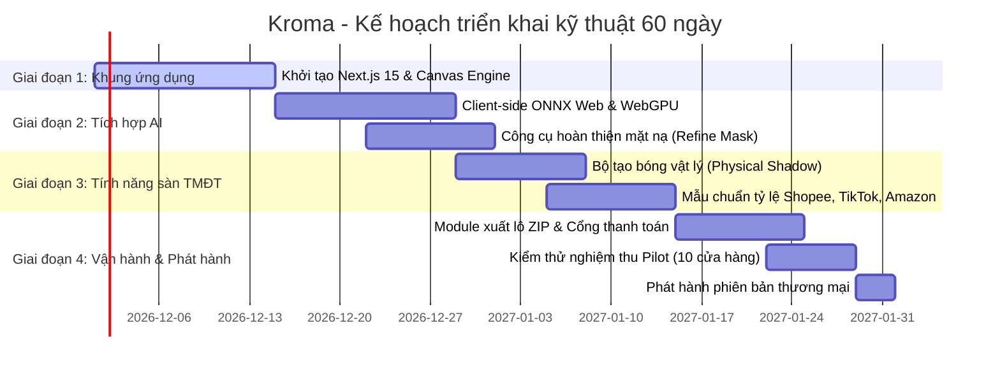

<div align="center">

  

  <p align="center" style="font-size: 15px; color: #475569; margin-top: 12px; margin-bottom: 20px;">
    Studio xử lý và chuẩn hóa ảnh sản phẩm thương mại điện tử
  </p>

  <p align="center">
    <code>v1.0.0-architecture</code> &nbsp;•&nbsp;
    <code>Client-Side WebGPU AI</code> &nbsp;•&nbsp;
    <code>Non-Destructive Graph</code> &nbsp;•&nbsp;
    <code>Maintainer: @JiaysTM17</code>
  </p>

</div>

---

### Mục lục
- [1. Giới thiệu](#1-giới-thiệu)
- [2. Năng lực cốt lõi](#2-năng-lực-cốt-lõi)
- [3. Kiến trúc kỹ thuật](#3-kiến-trúc-kỹ-thuật)
- [4. Hệ thống nhận diện thương hiệu](#4-hệ-thống-nhận-diện-thương-hiệu)
- [5. Cấu trúc mã nguồn và hồ sơ bàn giao](#5-cấu-trúc-mã-nguồn-và-hồ-sơ-bàn-giao)
- [6. Kế hoạch triển khai kỹ thuật](#6-kế-hoạch-triển-khai-kỹ-thuật)
- [7. Giấy phép và liên hệ](#7-giấy-phép-và-liên-hệ)

---

### 1. Giới thiệu

Kroma (mã dự án nội bộ: `XLAS`) là hệ thống ứng dụng web chuyên sâu phục vụ chuẩn hóa hình ảnh sản phẩm cho cá nhân kinh doanh, studio chụp ảnh thương mại và nhà bán lẻ trực tuyến. 

Hệ thống giải quyết bốn điểm nghẽn kỹ thuật điển hình trong vận hành hình ảnh thương mại điện tử:
1. **Bảo toàn chi tiết biên khi tách nền:** Giữ nguyên độ trong suốt của thủy tinh, viền ren, sợi vải dệt và chất liệu kim loại phản xạ.
2. **Chiều sâu vật lý:** Tái tạo bóng đổ tiếp xúc (Contact shadow) và bóng sàn góc nghiêng (Directional floor shadow) sau khi tách nền thô, đưa vật thể vào không gian quang học chân thực.
3. **Quy chuẩn hiển thị đa kênh:** Tự động điều chỉnh kích thước và tỷ lệ diện tích chủ thể theo thông số kỹ thuật bắt buộc của Shopee, TikTok Shop, Lazada và Amazon.
4. **Chi phí hạ tầng tính toán:** Tận dụng công nghệ WebGPU trên trình duyệt người dùng để chạy mô hình phân đoạn thị giác, loại bỏ phụ thuộc vào cụm máy chủ GPU đám mây đắt đỏ.

---

### 2. Năng lực cốt lõi

#### 2.1 Phân đoạn ngữ nghĩa và hoàn thiện mặt nạ (Semantic Masking)
- Tự động phát hiện biên chủ thể bằng mô hình mạng nơ-ron tích chập nhẹ (RMBG-1.4 / BiRefNet) biên dịch qua WebAssembly và ONNX Runtime Web.
- Bút tinh chỉnh viền (Refine edge brush) với bán kính tùy biến, cho phép xử lý thủ công các vùng chuyển tiếp phức tạp như lông thú, tóc và sợi tổng hợp.
- Ba chế độ kiểm tra nền: Nền trắng tuyệt đối (`#FFFFFF`), nền tối kiểm tra ánh sáng viền (`#0F172A`) và lưới ca-rô độ trong suốt tiêu chuẩn.

#### 2.2 Tái tạo bóng đổ vật lý (Physical Shadow Generator)
- **Contact Shadow:** Vùng tối đậm tại chân đế sản phẩm mô phỏng cơ chế che khuất ánh sáng môi trường (Ambient occlusion).
- **Directional Floor Shadow:** Bóng đổ dài theo tọa độ nguồn sáng nhân tạo (Độ dài, độ mờ biên, góc xiên từ 0° đến 360°).
- **Specular Reflection:** Tạo ảnh phản chiếu mờ dần trên bề mặt kính và nước cho các sản phẩm mỹ phẩm, đồng hồ và đồ gia dụng cao cấp.

#### 2.3 Bộ mẫu kích thước sàn giao dịch (Marketplace Preset Engine)
- **Shopee:** Tỷ lệ 1:1, độ phân giải 1024 × 1024 px, nén định dạng WebP/JPEG tối ưu tốc độ tải trên thiết bị di động.
- **TikTok Shop:** Tỷ lệ khung hình dọc 3:4 (1200 × 1600 px) và vuông 1:1, căn biên an toàn cho các nút chức năng giao diện ứng dụng.
- **Amazon / Google Shopping:** Nền trắng tinh khiết RGB (255, 255, 255), tự động căn chỉnh chủ thể chiếm đúng **85% diện tích khung ảnh** theo tiêu chuẩn niêm yết quốc tế.
- **Batch Export:** Xuất đồng thời nhiều định dạng và tỷ lệ từ một ảnh nguồn duy nhất theo công thức cấu hình (Export recipes).

#### 2.4 Quản lý màu và chỉnh sửa không phá hủy (Non-Destructive Pipeline)
- Dữ liệu ảnh nguồn được bảo toàn tuyệt đối ở trạng thái chỉ đọc (Read-only immutable asset).
- Đồ thị xử lý nội bộ dùng không gian màu tuyến tính (Linear sRGB) với độ chính xác số thực dấu phẩy động 32-bit (RGBA Float32) và quy ước alpha nhân trước (Premultiplied alpha).
- Lịch sử thao tác theo mô hình lệnh (Command pattern), cho phép hoàn tác vô hạn và phục hồi trạng thái làm việc sau sự cố (Crash recovery journal).

#### 2.5 Công thái học Studio & Điều hướng thông minh (Studio Ergonomics)
- **Cơ chế Dán ảnh Toàn cục (Global Clipboard Paste `Ctrl+V`):** Hỗ trợ dán trực tiếp ảnh chụp màn hình (Snipping Tool) hoặc copy từ trình duyệt vào KROMA ngay lập tức, tự động kiểm tra MIME và tạo tài sản trong hàng chờ mà không cần lưu ra ổ cứng.
- **Căn chỉnh Từ tính & Thước gióng Tâm (Magnetic Snapping & Center Guides):** Tự động bắt dính vào tâm X=0 / Y=0 khi kéo thả trong phạm vi 4px, hiển thị đường gióng tọa độ màu chàm (Magnetic Indigo `#6366F1`).
- **Điều hướng Vi mô bằng Bàn phím (Keyboard Nudge):** Di chuyển đối tượng chính xác từng pixel bằng 4 phím mũi tên (bước 1px, giữ `Shift` bước 10px), phím `Delete`/`Backspace` để xóa ảnh, phím `0` để đặt lại zoom 100%.
- **Khung Bao Biến đổi Kèm Nhãn Kích thước (Bounding Box with Dimension Badge):** 8 điểm neo điều khiển quanh sản phẩm kèm nhãn hiển thị chính xác chiều rộng và chiều cao (`W × H px`) thời gian thực.
- **Trình Quản lý Lớp vẽ Trực quan (Canvas Layer Stack):** Kiểm soát độc lập Watermark, Khung tem, Chủ thể sản phẩm, Bóng đổ quang học và Phông nền sàn với nút con mắt ẩn/hiện tức thì.
- **Bộ Lọc Cân Bằng Nhanh 1-Chạm:** Tích hợp các bộ lọc màu chuẩn TMĐT: *Auto-Enhance*, *Tươi tắn TMĐT*, *Trong trẻo Studio*.
- **Kiến trúc Zero-State Tối giản:** Khởi động ứng dụng sạch sẽ với 0 ảnh mẫu, trung tâm là khung tải ảnh sang trọng hỗ trợ kéo thả và hướng dẫn 3 bước.

---

### 3. Kiến trúc kỹ thuật

Kroma sử dụng mô hình lai **Client-Side First**, phân tách ranh giới rõ ràng giữa tác vụ render đồ họa và dịch vụ quản trị:

```
+-------------------------------------------------------------------------+
|                       TRÌNH DUYỆT KHÁCH HÀNG (CLIENT)                   |
|                                                                         |
|  +--------------------+  +---------------------+  +------------------+  |
|  |     Next.js 15     |  |   WebGL / WebGPU    |  | ONNX Runtime Web |  |
|  |  Giao diện & State |  |   Canvas Engine     |  | Inference cục bộ |  |
|  |  TypeScript & CSS  |  |  Biến đổi Float32   |  | Không tốn GPU    |  |
|  +--------------------+  +---------------------+  +------------------+  |
+-------------------------------------------------------------------------+
                                    |
                           HTTPS / WSS (REST API)
                                    |
+-------------------------------------------------------------------------+
|                          HẠ TẦNG ĐÁM MÂY (BACKEND)                      |
|                                                                         |
|  +--------------------+  +---------------------+  +------------------+  |
|  |   FastAPI Service  |  |    PostgreSQL 16    |  | Private Storage  |  |
|  |   Stateless REST   |  |   Catalog & Presets |  | S3 / R2 Bucket   |  |
|  +--------------------+  +---------------------+  +------------------+  |
+-------------------------------------------------------------------------+
```

| Thành phần | Công nghệ lựa chọn | Mục đích sử dụng |
| :--- | :--- | :--- |
| **Giao diện người dùng** | Next.js 15, React 19, Tailwind CSS | Điều phối luồng thao tác, quản lý thư viện ảnh và dự án |
| **Engine hiển thị** | HTML5 Canvas, WebGL2, WebGPU Shader | Hiển thị thời gian thực, pan/zoom mượt mà với ảnh độ phân giải cao |
| **Mô hình thị giác máy tính** | RMBG-1.4, BiRefNet qua ONNX Runtime Web | Tách nền trực tiếp trên chip đồ họa của máy người dùng |
| **Máy chủ API** | Python 3.11, FastAPI | Xác thực người dùng, lưu cấu hình mẫu và quản lý phiên làm việc |
| **Cơ sở dữ liệu** | PostgreSQL 16, SQLite (cho bản local) | Lưu trữ thông tin tài liệu, siêu dữ liệu dự án và lịch sử sửa đổi |
| **Kho lưu trữ tệp** | Cloudflare R2 / AWS S3 | Lưu trữ tài sản xuất bản và bản sao lưu có phân quyền |

---

### 4. Hệ thống nhận diện thương hiệu

Biểu tượng Kroma được xây dựng dựa trên nguyên lý khúc xạ quang học và khoa học phân tích sắc độ (Chroma):

```
       Trục Canvas vững chãi           Dải quang phổ sáng tạo AI
            [ Pillar ]                    [ Upper Beam ]
                 │                              ▲
                 │        ┌─────────────────────┘
                 ▼        ▼
               ┌───┐    ╱╲
               │   │   ╱  ╲     Tâm hội tụ: Lăng kính quang học & Khẩu độ
               │   ├──┤ ★  ├─── [ Prism Core & Lens Aperture ]
               │   │   ╲  ╱
               └───┘    ╲╱
                          ▼
                    [ Lower Beam ]
              Dải bóc tách nền & Layer
```

#### Bảng màu nhận diện chuẩn (Brand Palette)

| Sắc độ | Tên quy ước | Mã HEX | Vai trò trong hệ thống |
| :--- | :--- | :--- | :--- |
| █ | **Electric Indigo** | `#4F46E5` | Màu công nghệ chủ đạo, logic thuật toán và sự ổn định |
| █ | **Cyan Glaze** | `#06B6D4` | Điểm nhấn quang học, viền mặt nạ sắc nét và trong trẻo |
| █ | **Radiant Coral** | `#F43F5E` | Sắc độ bão hòa, kích thích thị giác cho sản phẩm thương mại |
| █ | **Optic Amber** | `#FACC15` | Điểm sáng khúc xạ thấu kính tại tâm khẩu độ |
| █ | **Obsidian Slate** | `#0F172A` | Màu chữ và đường nét kỹ thuật, tương phản cao trên nền trắng |
| █ | **Pure Canvas White**| `#FFFFFF` | Nền tiêu chuẩn hiển thị của thương mại điện tử quốc tế |

---

### 5. Cấu trúc mã nguồn và hồ sơ bàn giao

Toàn bộ tài liệu phân tích nghiệp vụ, kiến trúc kỹ thuật và tài nguyên vector được tổ chức theo cấu trúc phân tầng:

```
kroma/
├── README.md                                          # Tài liệu tổng quan dự án
├── .gitignore                                         # Cấu hình loại trừ tệp tạm hệ thống và Office
│
├── frontend/                                          # Giao diện Studio Next.js 15 & React 19
│   ├── src/app/                                       # App Router: Studio chính và Cổng Proofing khách
│   ├── src/components/                                # Workspace Canvas, Toolbar, Presets, Shadow & Adjustments
│   ├── src/lib/                                       # Float32 Color Pipeline, Physical Shadow & Types
│   ├── public/assets/logo/                            # Vector SVG Logo chuẩn hiển thị
│   ├── package.json                                   # Cấu hình phụ thuộc và scripts Next.js
│   └── tailwind.config.ts                             # Bảng màu sắc & lưới chuẩn craft design
│
├── backend/                                           # Máy chủ cục bộ FastAPI & Hexagonal Architecture
│   ├── app/main.py                                    # Điểm khởi chạy API và middleware CORS/Security
│   ├── app/api/v1/                                    # Tuyến API v1: Projects, Assets, Presets, Batches, Proofing, Quality, Health
│   ├── app/routers/                                   # Proofing link và Export ZIP service
│   ├── app/domain/                                    # Mô hình nghiệp vụ thuần túy (Domain Purity & Rules)
│   ├── app/services/                                  # Tầng dịch vụ: AssetService, PresetService, ProjectService, BatchWorker, ProofingService, QualityInspectionService
│   ├── app/storage/                                   # Triển khai SQLite WAL, Local FS Blob Store, Ports & Stubs
│   ├── pyproject.toml                                 # Cấu hình gói và pytest runner
│   └── tests/                                         # 54 bài kiểm thử tự động E2E & Unit (100% Passing)
│
├── e2e/                                               # Khung kiểm thử hộp đen E2E Đa Tầng (Playwright)
│   ├── tests/tier1/                                   # F01-F10 Functional Spec tests
│   ├── tests/tier2/                                   # Boundary Value Analysis (BVA) Backend & Frontend
│   ├── tests/tier3/                                   # Pairwise Combinations (Sàn & Định dạng ảnh)
│   └── tests/tier4/                                   # Real-world merchant workflows (Upload -> Edit -> ZIP)
│
├── 01_HO_SO_THIET_KE_HE_THONG/                        # Hồ sơ đặc tả kỹ thuật và nghiệp vụ (.docx)
│   ├── 00_DANH_MUC_HO_SO_VA_HUONG_DAN_IN.docx         # Danh mục tổng hợp và quy cách xuất bản
│   ├── 01_PHAN_TICH_NGHIEP_VU_VA_YEU_CAU_SAN_PHAM.docx# 30 nhóm chức năng, 14 use cases, 48 tiêu chuẩn CX
│   ├── 02_KIEN_TRUC_HE_THONG_VA_CAU_TRUC_MA_NGUON.docx# Thiết kế phân tầng, luồng dữ liệu, ADR01-ADR06
│   ├── 03_CONG_NGHE_VA_CONG_CU_PHAT_TRIEN.docx        # Đánh giá nền tảng, ma trận phần cứng và giấy phép
│   ├── 04_THIET_KE_DU_LIEU_API_VA_AI.docx             # Hợp đồng ảnh Float32, lược đồ job và vòng đời AI
│   └── 05_KE_HOACH_TRIEN_KHAI_KIEM_THU_VAN_HANH.docx  # Kế hoạch bàn giao, chiến lược test và ngân sách
│
├── 02_CHIEN_LUOC_SAN_PHAM_VA_DE_XUAT_TOI_UU/          # Đánh giá chiến lược nền tảng và lộ trình MVP (.docx)
│   └── 07_BAO_CAO_DANH_GIA_VA_DE_XUAT_TOI_UU_KROMA.docx
│
└── 03_THUONG_HIEU_VA_THIET_KE_LOGO_KROMA/             # Hệ thống nhận diện thương hiệu Kroma
    ├── 06_THUYET_MINH_THUONG_HIEU_VA_LOGO_KROMA.docx  # Thuyết minh ý niệm hình học và ngữ nghĩa học (.docx)
    ├── Assets_Vector_SVG/                             # Bộ tệp vector SVG tỷ lệ chuẩn (Optical Kerning chuẩn)
    │   ├── kroma-logo-horizontal.svg                  # Biến thể ngang chính thức
    │   ├── kroma-logo-stacked.svg                     # Biến thể khối vuông
    │   ├── kroma-icon.svg                             # Biểu tượng Favicon
    │   ├── kroma-app-icon.svg                         # Biểu tượng ứng dụng bo góc
    │   └── kroma-logo-monochrome.svg                  # Biến thể đơn sắc đen in ấn
    └── Showcase_Hinh_Anh/
        ├── kroma_logo_presentation.jpg                # Bản kết xuất độ phân giải cao 1376 × 768 px
        └── index.html                                 # Bảng hiển thị thông số và tải tài nguyên
```

---

### 5.1 Hướng dẫn cài đặt và vận hành (Quickstart)

#### Khởi chạy Backend (FastAPI & SQLite)
```bash
cd backend
python -m venv .venv
source .venv/bin/activate  # Trên Windows: .venv\Scripts\activate
pip install -r requirements.txt

# Chạy toàn bộ 54 test tự động (100% Pass)
pytest -v

# Chạy máy chủ phát triển tại cổng 8000
python -m uvicorn app.main:app --reload --port 8000
```

#### Khởi chạy Frontend (Next.js 15 & React 19)
```bash
cd frontend
npm install

# Kiểm tra bản đóng gói sản phẩm
npm run build

# Chạy máy chủ giao diện tại cổng 3005
npm run dev
```

Mở trình duyệt truy cập:
- Studio Image Suite: `http://localhost:3005`
- API Swagger Docs: `http://localhost:8000/docs`
- Cổng duyệt khách hàng (Proofing): `http://localhost:3005/proof/demo`

---

### 6. Kế hoạch triển khai kỹ thuật



---

### 7. Giấy phép và liên hệ

- **Tác giả & Chủ sở hữu dự án:** [JiaysTM17](https://github.com/JiaysTM17)
- **Bản quyền:** © 2026 Kroma. Toàn bộ thiết kế nhãn hiệu và tài liệu kiến trúc được bảo lưu quyền tác giả.
