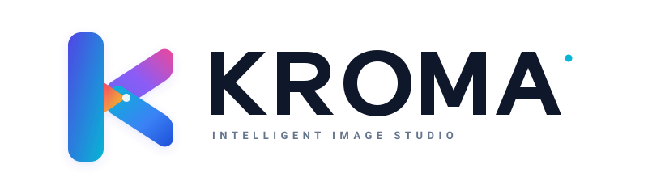
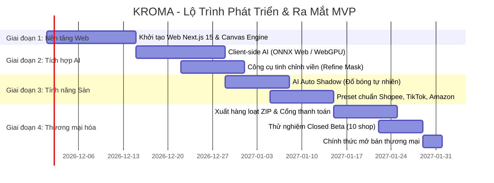

<div align="center">

  

  <br />

  <p align="center">
    <strong>Nền Tảng Xử Lý Ảnh Sản Phẩm Thông Minh Dành Riêng Cho Thương Mại Điện Tử</strong>
    <br />
    <em>Intelligent Image Studio for Next-Gen E-Commerce</em>
  </p>

  <p align="center">
    <a href="#-gi%E1%BB%9Bi-thi%E1%BB%87u-d%E1%BB%B1-%C3%A1n"></a>
    <a href="#-ki%E1%BA%BFn-tr%C3%BAc--c%C3%B4ng-ngh%E1%BB%87"></a>
    <a href="#-b%E1%BB%99-t%C3%A0i-li%E1%BB%87u-d%E1%BB%B1-%C3%A1n"></a>
    <a href="https://github.com/JiaysTM17"></a>
  </p>

</div>

---

## 📌 MỤC LỤC
- [1. Giới Thiệu Dự Án](#-giới-thiệu-dự-án)
- [2. Điểm Đột Phá & Tính Năng Trọng Tâm](#-điểm-đột-phá--tính-năng-trọng-tâm)
- [3. Kiến Trúc & Công Nghệ Hiện Đại (Web Client-Side AI)](#-kiến-trúc--công-nghệ-hiện-đại)
- [4. Hệ Thống Nhận Diện Thương Hiệu KROMA](#-hệ-thống-nhận-diện-thương-hiệu-kroma)
- [5. Danh Mục Hồ Sơ & Tài Liệu Kỹ Thuật](#-danh-mục-hồ-sơ--tài-liệu-kỹ-thuật)
- [6. Lộ Trình Triển Khai MVP (60 Ngày)](#-lộ-trình-triển-khai-mvp-60-ngày)
- [7. Bản Quyền & Tác Giả](#-bản-quyền--tác-giả)

---

## 🚀 GIỚI THIỆU DỰ ÁN

**KROMA** (tên mã phát triển nội bộ: `XLAS`) là hệ thống ứng dụng web chuyên sâu về xử lý và chuẩn hóa hình ảnh sản phẩm thương mại điện tử. 

Dự án được thiết kế xuất phát từ nỗi đau lớn nhất của hàng triệu **Nhà bán hàng online (E-commerce Sellers), Freelancers và Studio chụp ảnh**:
- Tốn hàng giờ tách nền thủ công từng ảnh, viền lem nhem, mất chi tiết sợi vải/tóc/chai thủy tinh.
- Sau khi tách nền, sản phẩm bị "trơ trọi", không có chiều sâu nếu không đổ bóng tự nhiên.
- Mất thời gian co kéo, căn chỉnh thủ công theo kích thước từng sàn (Shopee 1:1, TikTok Shop 3:4/1:1, Amazon 85% nền trắng).
- Bị đối thủ sao chép, đánh cắp hình ảnh sản phẩm khi đăng bán.
- Chi phí thuê server GPU xử lý AI đám mây quá đắt đỏ khiến mô hình kinh doanh SaaS khó có lãi.

**KROMA giải quyết toàn diện các vấn đề trên** bằng một quy trình xử lý ảnh thông minh, áp dụng triết lý *chỉnh sửa không phá hủy (Non-destructive)* và công nghệ *Client-side AI* tối ưu chi phí vận hành.

---

## ✨ ĐIỂM ĐỘT PHÁ & TÍNH NĂNG TRỌNG TÂM

### 1. 🎯 Tách Nền AI & Tinh Chỉnh Mặt Nạ Siêu Nét (Precision Masking)
* Tự động nhận diện chủ thể sản phẩm, bóc tách nền với độ phân giải cao trong tích tắc.
* Hỗ trợ cọ tinh chỉnh viền (Refine Brush), giữ nguyên chi tiết trong suốt, sợi vải, tóc và trang sức.
* Kiểm tra tức thì trên nhiều nền: Trắng tinh khiết, đen studio, caro trong suốt (transparency checkerboard).

### 2. 🪄 AI Auto Shadow (Đổ Bóng Tự Nhiên Thông Minh)
* **Drop Shadow:** Bóng đổ mềm mại dưới đáy sản phẩm tạo cảm giác đặt vững chãi trên mặt bàn.
* **Floor Shadow:** Bóng đổ ngả góc theo nguồn sáng nhân tạo như trong studio chuyên nghiệp.
* **Reflection Shadow:** Bóng phản chiếu mặt kính / mặt nước cho mỹ phẩm và đồ điện tử sang trọng.

### 3. 📐 Bộ Preset Kích Thước Chuẩn Sàn 1-Click
* **Shopee:** Chuẩn vuông 1024x1024 px, tối ưu dung lượng tải nhanh trên app di động.
* **TikTok Shop:** Tỷ lệ chuẩn 1:1 và 3:4 chuẩn hóa khung hình dọc.
* **Amazon / Google Shopping:** Tự động đưa về nền trắng tinh khiết (RGB 255,255,255) và căn tỷ lệ sản phẩm chiếm đúng **85% diện tích khung hình** theo quy chuẩn quốc tế.
* **Lazada & Tiki:** Tự động điều chỉnh padding và vị trí logo thương hiệu.

### 4. 🛡️ Smart Watermark & Khung Flash Sale Hàng Loạt
* Đóng khung khuyến mại (Freeship Xtra, Flash Sale, Voucher Khủng) hàng loạt mà không làm méo hình dáng sản phẩm.
* Chèn Watermark thông minh (chìm/nổi) để chống đánh cắp ảnh trên sàn TMĐT.

### 5. 📱 Mobile Proofing Link (Duyệt Ảnh 1 Chạm Cho Khách Hàng)
* Freelancer/Studio xử lý xong chỉ cần xuất 1 đường link gửi khách xem trên điện thoại.
* Khách duyệt, thích hoặc thả ghim yêu cầu sửa trực tiếp trên từng vùng ảnh; phản hồi đồng bộ tức thì.

### 6. 🔄 Chỉnh Sửa Không Phá Hủy (Non-Destructive Pipeline)
* Bảo toàn 100% tệp gốc. Mọi thao tác cắt, xoay, chỉnh sáng, tách nền được lưu thành đồ thị tham số (Graph Revision).
* Undo/Redo không giới hạn, phục hồi trạng thái sau sự cố (Crash Recovery).

---

## 🛠️ KIẾN TRÚC & CÔNG NGHỆ HIỆN ĐẠI

KROMA tiên phong áp dụng mô hình **Hybrid Client-Side AI**, giúp nền tảng chạy siêu nhanh mà **tiết kiệm đến 95% chi phí máy chủ GPU**:

```
                       [ TRÌNH DUYỆT NGƯỜI DÙNG (CLIENT) ]
                                       │
     ┌─────────────────────────────────┼────────────────────────────────┐
     ▼                                 ▼                                ▼
[ Next.js 15 / React ]       [ WebGL / WebGPU Canvas ]      [ ONNX Runtime Web / WASM ]
 Giao diện người dùng         Render hình ảnh 60fps          Mô hình AI RMBG / BiRefNet
 Quản lý bộ sưu tập ảnh       Cắt, xoay, áp bộ lọc màu       Tách nền trực tiếp bằng GPU máy trạm
                                       │                     (KHÔNG TỐN CHI PHÍ SERVER GPU!)
                                       │
                                       ▼ (Chỉ khi cần đồng bộ & tác vụ nặng)
                     [ HỆ THỐNG ĐÁM MÂY (BACKEND CLOUD) ]
                                       │
     ┌─────────────────────────────────┴────────────────────────────────┐
     ▼                                                                  ▼
[ FastAPI Stateless Backend ]                              [ Serverless AI Engine ]
 Quản lý tài khoản, Preset, Thanh toán                      Sinh phông nền nghệ thuật (Generative AI)
 PostgreSQL + Private Object Storage (S3/Cloudflare R2)     Chạy theo nhu cầu (Pay-as-you-go)
```

---

## 🎨 HỆ THỐNG NHẬN DIỆN THƯƠNG HIỆU KROMA

| Thành tố | Giá trị / Mã màu | Ý nghĩa thương hiệu |
| :--- | :--- | :--- |
| **Tên gọi KROMA** | Gốc từ *Khroma (χρῶμα)* | Biểu thị **độ thuần khiết, rực rỡ và bão hòa tuyệt đối của màu sắc (Chroma)**. Âm bật `/k/` dứt khoát, công nghệ cao. |
| **Cột đứng Canvas** | Trục dọc chữ K | Đại diện cho **ảnh gốc nguyên bản** và triết lý **chỉnh sửa không phá hủy**. |
| **Dải quang phổ trên** | `#4F46E5` → `#F43F5E` | Sức mạnh sáng tạo và nâng cấp của **Trí tuệ Nhân tạo (AI Enhancement)**. |
| **Dải cắt lớp dưới** | `#06B6D4` → `#1D4ED8` | Kỹ thuật **bóc tách layer, tách nền viền siêu nét** và đổ bóng tự nhiên. |
| **Lăng kính hội tụ** | Khẩu độ quang học trung tâm | Trái tim thuật toán xử lý hàng loạt (**Batch Processing Engine**). |
| **Nền Trắng Chuẩn** | `#FFFFFF` | Tiêu chuẩn vàng của thương mại điện tử quốc tế (Amazon, Google Shopping). |

---

## 📁 DANH MỤC HỒ SƠ & TÀI LIỆU KỸ THUẬT

Toàn bộ tài liệu phân tích, kiến trúc và nhận diện thương hiệu được đóng gói hoàn chỉnh trong kho lưu trữ:

```
XLAS/
├── 01_HO_SO_THIET_KE_HE_THONG/
│   ├── 00_DANH_MUC_HO_SO_VA_HUONG_DAN_IN.docx            # Danh mục hồ sơ & hướng dẫn xuất bản
│   ├── 01_PHAN_TICH_NGHIEP_VU_VA_YEU_CAU_SAN_PHAM.docx   # 30 nhóm chức năng, 48 yêu cầu CX, 14 use cases
│   ├── 02_KIEN_TRUC_HE_THONG_VA_CAU_TRUC_MA_NGUON.docx   # Phân tầng kiến trúc, module, ADR01-ADR06
│   ├── 03_CONG_NGHE_VA_CONG_CU_PHAT_TRIEN.docx           # So sánh nền tảng, stack kỹ thuật, giấy phép
│   ├── 04_THIET_KE_DU_LIEU_API_VA_AI.docx                # Hợp đồng ảnh Float32, API, vòng đời AI, ledger
│   └── 05_KE_HOACH_TRIEN_KHAI_KIEM_THU_VAN_HANH.docx     # Kế hoạch Sprint, ma trận kiểm thử, budget
│
├── 02_CHIEN_LUOC_SAN_PHAM_VA_DE_XUAT_TOI_UU/
│   └── 07_BAO_CAO_DANH_GIA_VA_DE_XUAT_TOI_UU_KROMA.docx  # Đánh giá Web vs Desktop, lộ trình thêm/bớt tính năng
│
└── 03_THUONG_HIEU_VA_THIET_KE_LOGO_KROMA/
    ├── 06_THUYET_MINH_THUONG_HIEU_VA_LOGO_KROMA.docx     # Thuyết minh triết lý thiết kế & ngữ nghĩa học
    ├── Assets_Vector_SVG/                                # Trọn bộ 5 định dạng Vector SVG chuẩn quốc tế
    │   ├── kroma-logo-horizontal.svg                     # Logo ngang chính thức
    │   ├── kroma-logo-stacked.svg                        # Logo khối vuông
    │   ├── kroma-icon.svg                                # Biểu tượng Favicon
    │   ├── kroma-app-icon.svg                            # App badge bo góc
    │   └── kroma-logo-monochrome.svg                     # Bản đơn sắc đen in ấn
    └── Showcase_Hinh_Anh/
        ├── kroma_logo_presentation.jpg                   # Bản render phối cảnh 1376x768
        └── index.html                                    # Trang Web Brand Showcase tương tác trực tiếp
```

---

## 📅 LỘ TRÌNH TRIỂN KHAI MVP (60 NGÀY)



---

## 👤 BẢN QUYỀN & TÁC GIẢ

*   **Chủ sở hữu & Nhà phát triển:** [JiaysTM17](https://github.com/JiaysTM17)
*   **Dự án:** KROMA Intelligent Image Studio
*   **Bản quyền:** © 2026 KROMA. Toàn bộ tài liệu thiết kế và nhãn hiệu đã được đăng ký và bảo hộ.
